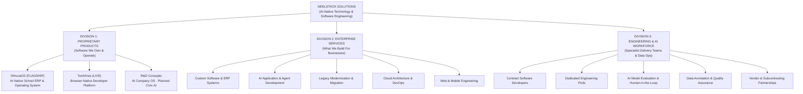

# NEELSTACK SOLUTIONS — BUSINESS POSITIONING AUDIT
**Document ID:** `AUDIT-BIZ-POS-01`  
**Date:** 09 November 2026  
**Status:** Complete  
**Scope:** Homepage, Services Hub, Products Hub, Navigation, About, and Footer  
**Benchmark Reference:** [Baytech Consulting](https://www.baytechconsulting.com/) vs. NeelStack Solutions  

---

## 1. Executive Summary & Core Positioning Gap

### Current State
The NeelStack website currently communicates multiple conflicting identities across different sections:
1. **On the Homepage Hero:** It oscillates between an AI agency ("Software Engineering & AI Systems", "AI Engineering & LLM Integration"), a SaaS product company (promoting ToolVines and DhruvaOS), and a boutique consultancy.
2. **In Products:** Five distinct product concepts (`ToolVines`, `DhruvaOS`, `AI Company OS`, `NaukariMitra`, `SarkariMitra`) are showcased with similar visual weighting, diluting the prominence of **DhruvaOS** (the primary commercial flagship).
3. **In Services:** While 11 engineering disciplines are listed, there is **no clear B2B workforce offering** (Contract Engineering, Dedicated Engineering Pods) and **no dedicated AI Data Operations & Model Evaluation service**, even though enterprise clients and vendor partners (Accenture, Cognizant, iMerit, Shaip) actively procure these exact capabilities.
4. **In Legacy Modernization:** Currently treated as a sub-bullet inside "Enterprise Platforms", rather than positioned as a high-margin enterprise core offering.

### Recommended Target Positioning
> **"NeelStack Solutions is an AI-native technology company building proprietary software products, engineering custom business applications, modernising legacy systems, and delivering specialised AI and software engineering capabilities through flexible delivery teams."**

---

## 2. Three Complementary Business Divisions Framework

To eliminate the perception of being an "unrelated collection of services", all customer touchpoints, navigation menus, and proposal collateral must align to three distinct divisions:

---

## 3. Detailed Division Audit & Remediation

### Division 1: Proprietary Software Products
| Product | Current Status on Site | Actual Production Reality | Business Impact & Finding | Recommended Position |
| :--- | :--- | :--- | :--- | :--- |
| **DhruvaOS** (`dhruvaos.com`) | Listed #2 behind ToolVines on products page; conflicting launch dates (Oct 2 vs Nov 14). | Ready for Launch · Public Beta Live · Onboarding early pilot institutions · Launch 14 Nov 2026. | High: Dilutes company flagship story; schools see ToolVines first instead of the educational ERP. | **Elevate to #1 Flagship**. Hero showcase on homepage; dedicated enterprise school landing pages; clear "Book a Demo" CTA. |
| **ToolVines** (`toolvines.com`) | Listed as Track 1 Flagship on `/products`; claims "320+ tools", "zero telemetry", "100% offline". | Live browser-based productivity & developer utility platform. | Medium: When placed alongside enterprise ERP, creates confusion about whether NeelStack is a B2C utility maker or enterprise firm. | **Position as independent live product**: "Proof of product engineering craft" — proving NeelStack builds, deploys, and scales its own software. |
| **AI Company OS** | Listed as a shipped/scaling platform with "11 specialized agent squads". | Whitepaper v1.0 & Research Framework published at `/whitepapers/ai-company-operating-system`. | High: Enterprise clients confuse research framework with off-the-shelf software. | Classify as **"R&D Architecture & Framework"**, linking directly to the strategic whitepaper. |
| **NaukariMitra** & **SarkariMitra** | Given equal visual cards on `/products` and `/roadmap` as live/near-term products. | Conceptual roadmap / planned civic AI initiatives. | Medium: Distracts B2B and enterprise evaluators with consumer/civic concepts. | Consolidate under **"Civic AI Research & Future Concepts"** with prominent disclaimers. |

---

### Division 2: Enterprise Software & AI Engineering
| Existing Service ID | Current Scope | Missing Enterprise Angles | Recommended Adjustment |
| :--- | :--- | :--- | :--- |
| `custom-software` | Tailored ERPs & portals. | Lacks clear enterprise migration methodology. | Highlight bespoke architectural design, data integrity, and legacy system replacement. |
| `ai-development` | LangGraph, MCP, RAG. | Strong, but over-relies on "Sub-50ms inference guarantee" which is model-dependent. | Rephrase SLA metrics to defensible engineering standards (e.g. deterministic guardrails, structured JSON outputs, private VPC inference). |
| `enterprise-platforms` | Generic platform engineering. | Covers modernization only as an afterthought. | **Elevate Legacy Modernization into a Tier-1 Service** (`/services/legacy-modernisation`). Focus on monolith deconstruction, database migration, and risk-mitigated phased rollouts. |
| `devops-cloud` | Docker, K8s, Terraform. | Good coverage. | Add explicit cloud cost optimization and infrastructure audit workflows. |
| `web-applications` | Next.js, React. | Good coverage. | Maintain high-performance positioning. |

---

### Division 3: Engineering & AI Workforce (New Strategic Pillar)
Currently, NeelStack does not have dedicated routes or structured service offerings for workforce solutions. To qualify as an enterprise vendor for IT services companies, system integrators, and AI labs, NeelStack must introduce:

1. **Contract Software Engineering & Dedicated Teams:**
   - **Service Definition:** Supplying specialized frontend, backend, full-stack, Python, Java, DevOps, and AI engineers.
   - **Delivery Models:** Individual staff augmentation (contract developers) and managed cross-functional squads (Dedicated Engineering Pods).
   - **Transparency Mandate:** Explicitly state the delivery model: Direct core engineers supplemented by screened contractually-engaged professionals and vetted delivery partners under strict master service agreements (MSAs) and client IP protection.
2. **AI Data Operations & Model Evaluation:**
   - **Service Definition:** Human-in-the-loop (HITL) AI evaluation, RLHF preference ranking, prompt-response accuracy benchmarking, domain-specific data annotation, and multimodal dataset validation.
   - **Target Clients:** AI research labs, enterprise LLM adopters, and data curation vendors requiring managed evaluation operations.
3. **Vendor & Subcontracting Partnerships:**
   - **Dedicated Portal/Page:** A dedicated `/partnerships` or `/vendor-partnerships` page designed for tier-1 IT firms and AI aggregators seeking subcontracting or specialized capability delivery.

---

## 4. Benchmark Comparison: Baytech Consulting vs. NeelStack

| Dimension | Baytech Consulting Standard | NeelStack Current State | NeelStack Target Upgrade |
| :--- | :--- | :--- | :--- |
| **Visual Tone** | Ultra-minimal, dark-first, crisp typography, generous spacing, zero visual noise. | Neo-brutalist tactile cards, colorful badges, rich interactive canvas. | Preserve NeelStack's unique technical personality while adopting Baytech's minimal typography discipline and generous line-heights. |
| **Value Proposition** | 4-6 word punchy hero headline: *"Your Vision. Our Expertise. AI-Accelerated."* | Lengthy multi-line headline with carousel of 5 rotating slices. | Streamline hero headlines to punchy, authoritative statements without sacrificing left-side readability. |
| **Hero Focal Point** | Interactive, free-floating particle logo reacting to cursor displacement without bounding boxes. | Successfully implemented particle logo; now floating freely on page background. | Maintained and perfected. Color-morphs across primary brand pillars. |
| **Trust Proofing** | Clear case studies with real client challenges, technical architectures, and measurable outcomes. | Client case studies present but contain unverified statutory compliance claims (e.g. WORM compliance, HIPAA readiness). | Recalibrate case studies to highlight architectural blueprints, code-level benchmarks, and verified deliverables. |
| **Actionable CTAs** | Prominent "Schedule Free Consultation" + direct phone access. | Multiple conflicting buttons ("Start a Project", "Explore Services", "Book Consultation"). | Unify homepage primary CTAs to: **"Schedule Consultation"** and **"Explore Capabilities"**. |

---

## 5. Remediation Priority Matrix

| Item ID | Finding | Business Severity | Target Division | Remediation Action |
| :--- | :--- | :--- | :--- | :--- |
| `POS-01` | DhruvaOS relegated to #2 product slot | P0 (Critical) | Division 1 | Elevate DhruvaOS to primary flagship product on homepage and `/products`. |
| `POS-02` | Missing Workforce & Staffing Services | P0 (Critical) | Division 3 | Create dedicated `/services/contract-engineering` and `/services/dedicated-teams`. |
| `POS-03` | Missing AI Data & Model Evaluation | P1 (High) | Division 3 | Create dedicated `/services/ai-data-annotation` and `/services/ai-model-evaluation`. |
| `POS-04` | Legacy Modernization buried as sub-item | P1 (High) | Division 2 | Promote to standalone dedicated service page `/services/legacy-modernisation`. |
| `POS-05` | ToolVines presented as rival enterprise flagship | P2 (Medium) | Division 1 | Refactor ToolVines presentation as a live browser utility platform demonstrating engineering craft. |
| `POS-06` | Unsubstantiated "Zero-downtime" claims | P1 (High) | Division 2 | Replace with "Phased migration with dual-write synchronization and rollback protection". |
