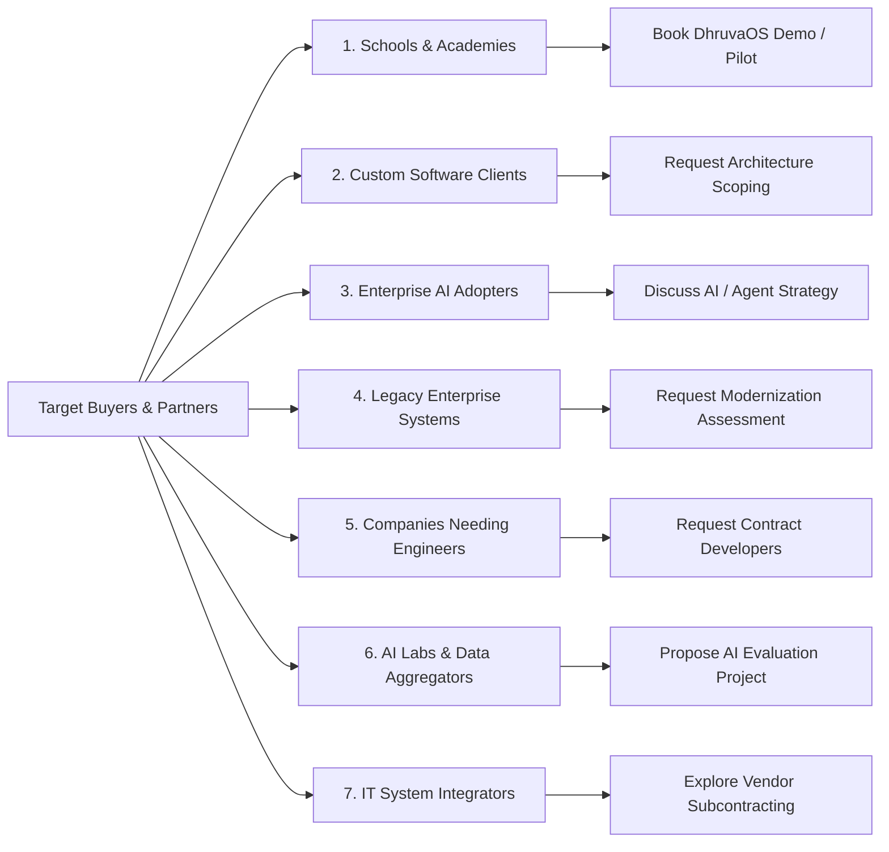

# NEELSTACK SOLUTIONS — CONVERSION & B2B VENDOR READINESS AUDIT
**Document ID:** `AUDIT-CONV-VEN-06`  
**Date:** 09 November 2026  
**Status:** Complete  
**Scope:** Conversion funnels, buyer personas, call-to-action (CTA) pathways, and vendor onboarding readiness  

---

## 1. Executive Summary & Buyer Persona Mapping

To successfully onboard enterprise clients, school trusts, and vendor partners (such as TCS, Accenture, Cognizant, iMerit, or Shaip), NeelStack's website must cater to **7 distinct buyer personas** with specialized value propositions and frictionless conversion paths:

---

## 2. Persona-Specific Conversion Funnel Audit

### Persona 1: School Principals, Trustees & Administrators (DhruvaOS)
- **Current State:** DhruvaOS has a dedicated showcase on the homepage and a product page at `/products/dhruvaos`.
- **Conversion Gap:** CTAs point to generic `/book-consultation` rather than a specialized educational intake form.
- **Recommended Action:**
  - Standardize CTA: **"Book an Institutional Demo"** or **"Apply for Early Pilot"**.
  - Add specific form dropdown options: *"Number of Students"*, *"Current Software (None/Legacy/Excel)"*, *"Key Challenge (Fees, Admissions, Attendance)"*.

### Persona 2: Mid-Market Businesses Needing Custom Software
- **Current State:** Solid service pages at `/services/custom-software` and `/services/web-applications`.
- **Conversion Gap:** Primary CTA is generic *"Start a Project"*.
- **Recommended Action:**
  - Standardize CTA: **"Schedule Architecture Call"** or **"Request Scope Assessment"**.
  - Highlight trust signals: Full IP assignment on milestone completion, direct senior engineer access, weekly agile demos.

### Persona 3: Enterprises Adopting AI, LLMs & Agents
- **Current State:** Strong technical content on LangGraph, MCP, and RAG at `/services/ai-development`.
- **Conversion Gap:** Lacks an intake question on existing LLM data readiness (VPC requirements, privacy constraints).
- **Recommended Action:**
  - Standardize CTA: **"Discuss AI Architecture & Guardrails"**.
  - Emphasize enterprise privacy: Private VPC deployment, zero training on client data, PII sanitization.

### Persona 4: Companies Modernizing Fragile Legacy Monoliths
- **Current State:** Buried under general platform engineering; mentions "zero downtime".
- **Conversion Gap:** Enterprise CTOs fear migration risk and data corruption above all else.
- **Recommended Action:**
  - Create dedicated route: `/services/legacy-modernisation`.
  - Standardize CTA: **"Request a Legacy Modernization Assessment"**.
  - Lead with risk mitigation: Strangler-fig deconstruction, dual-write synchronization, automated regression harnesses, zero vendor lock-in.

### Persona 5: Tech Companies Seeking Dedicated Developers (Staff Augmentation)
- **Current State:** **COMPLETELY MISSING** from current public conversion funnels!
- **Conversion Gap:** Potential clients seeking to hire 2–5 dedicated React, Python, or Go engineers find no direct engagement path.
- **Recommended Action:**
  - Create dedicated route: `/services/contract-engineering` and `/services/dedicated-teams`.
  - Standardize CTA: **"Request Developer Profiles & Rates"**.
  - Clear SLA: Candidate profiles presented within 48–72 hours; risk-free 2-week trial sprint.

### Persona 6: AI Companies & Labs Needing Evaluation / Data Annotation
- **Current State:** **COMPLETELY MISSING** from current public conversion funnels!
- **Conversion Gap:** AI aggregators (iMerit, Shaip, Scale AI partners) cannot find vendor information for model evaluation or data collection.
- **Recommended Action:**
  - Create dedicated route: `/services/ai-data-annotation` and `/services/ai-model-evaluation`.
  - Standardize CTA: **"Request Managed Evaluation Proposal"**.
  - Highlight domain capabilities: Multilingual Indian vernacular validation, code review benchmarking, RLHF ranking, strict QA pipelines.

### Persona 7: Tier-1 IT System Integrators Seeking Subcontractors (Vendor Partnerships)
- **Current State:** No dedicated vendor onboarding page.
- **Conversion Gap:** Partner procurement teams cannot verify subcontracting compliance, master service agreements, or vendor registration.
- **Recommended Action:**
  - Create dedicated route: `/partnerships` (or `/vendor-partnerships`).
  - Standardize CTA: **"Explore Vendor Partnership & Subcontracting"**.
  - Document compliance: CIN, GSTIN, MSME, Startup India, NDA procedures, IP indemnification.

---

## 3. Social Proof & Trust Architecture Audit

Enterprise buyers and procurement committees scrutinize claims. The audit mandates strict adherence to **truth-in-marketing**:

| Trust Signal | Policy & Compliance Standard | Status on Site |
| :--- | :--- | :--- |
| **Client Testimonials** | **NO FAKE REVIEWS.** Do not fabricate client quotes or employee testimonials. | `COMPLIANT` — Currently site relies on industry architectural patterns rather than invented quotes. |
| **Client Logos** | **NO UNLICENSED LOGOS.** Never display logos of Fortune 500 companies unless active signed contracts exist. | `COMPLIANT` — No fake Fortune 500 client logos are published. |
| **Government Claims** | **EXPLICIT DISCLAIMERS.** Products like `NaukariMitra` and `SarkariMitra` must never imply official state sponsorship. | `COMPLIANT` — Prominent legal disclaimers exist in `constants/products.ts`. |
| **Statutory Credentials** | **TRANSPARENT REGISTRATION.** Display official MCA incorporation, GSTIN, MSME, and Startup India numbers. | `COMPLIANT` — Implemented in `AccreditationBadges` component. |

---

## 4. Prioritized Conversion Remediations

1. **Add Dedicated Intake Selectors (P0):** Update `/contact` and `/book-consultation` to include high-intent dropdown categories:
   - *DhruvaOS School Demo*
   - *Custom Software & Web Application*
   - *Enterprise AI / Agentic System*
   - *Legacy Modernization Assessment*
   - *Contract Developers / Dedicated Pod*
   - *AI Model Evaluation / Data Operations*
   - *Vendor Subcontracting Partnership*
2. **Build Dedicated Partner Portal (P1):** Deploy `/partnerships` outlining vendor qualification criteria.
3. **Streamline Hero Action Triggers (P1):** Ensure all homepage hero CTA buttons route directly to high-intent conversion modals or forms.
