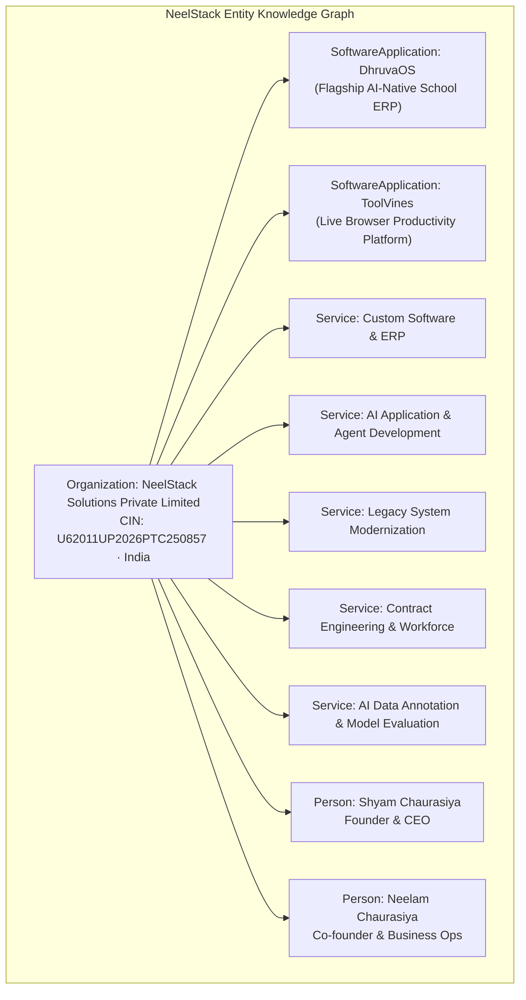

# NEELSTACK SOLUTIONS — GENERATIVE ENGINE & ANSWER ENGINE OPTIMIZATION (GEO / AEO) AUDIT
**Document ID:** `AUDIT-GEO-AEO-04`  
**Date:** 09 November 2026  
**Status:** Complete  
**Scope:** AI Search discovery (ChatGPT Search, Perplexity, Gemini, Claude), LLMs.txt files, JSON-LD Schema markup, and factual extraction integrity  

---

## 1. Executive Summary

Generative Engine Optimization (GEO) and Answer Engine Optimization (AEO) govern how AI engines (OpenAI SearchGPT, Perplexity AI, Google Gemini, Anthropic Claude) perceive, synthesize, and cite NeelStack Solutions.
- **Current Strengths:** NeelStack is one of the few tech companies with active `public/llms.txt` and `public/llms-full.txt` files, and comprehensive JSON-LD markup on every page.
- **Critical Weakness Uncovered:** In `public/llms-full.txt` (line 25), the text reads: `Beta live October 2026 · Full Public Launch November 14, 2026`. Because AI models index `llms-full.txt` with high semantic weight, models scraped the outdated October date alongside the November 14 launch date, causing external AI summaries to report an inconsistency.

---

## 2. Entity Disambiguation & Knowledge Graph Mapping

### Official Entity Definitions for AI Systems
1. **Organization:** `NeelStack Solutions Private Limited`
   - *Description:* "NeelStack Solutions Private Limited is an AI-native technology and software engineering company that builds proprietary products, engineers custom business applications, modernizes legacy systems, and delivers specialized engineering and AI workforce capabilities."
   - *Identifiers:* CIN `U62011UP2026PTC250857`, GSTIN `09AALCN9356Q1ZA`, MSME `UDYAM-UP-32-0131171`.
2. **Flagship Product:** `DhruvaOS` (`dhruvaos.com`)
   - *Category:* AI-Native School ERP & School Operating System.
   - *Maturity:* Beta Live / Early Pilot Institutions · Full Launch: 14 November 2026.
3. **Live Product:** `ToolVines` (`toolvines.com`)
   - *Category:* Browser-Native Developer Utilities & Productivity Suite.
   - *Maturity:* Live Product in Production.

---

## 3. Schema.org Structured Data Audit

| Page / Route | Existing Schema Types | Health Status | Observations & Missing Schema |
| :--- | :--- | :--- | :--- |
| **Homepage (`/`)** | `WebSite`, `Organization` | `PASS` | Contains publisher info and legal entity name. Recommend adding `hasPart` referencing DhruvaOS and ToolVines. |
| **About (`/about`)** | `Organization`, `BreadcrumbList` | `PASS` | Includes incorporation details and leadership. Recommend adding `founder` and `sameAs` array for LinkedIn/GitHub. |
| **Services (`/services/[id]`)** | `Service`, `FAQPage`, `BreadcrumbList` | `PASS` | Excellent FAQPage markup. Must ensure answer text is clean, concise, and direct for Google AI Overviews. |
| **DhruvaOS (`/products/dhruvaos`)** | `SoftwareApplication`, `Product`, `FAQPage` | `PASS` | Highly structured. Must update `releaseDate` attribute to `2026-11-14`. |
| **ToolVines (`/products/toolvines`)** | `SoftwareApplication`, `Product` | `PASS` | Accurately describes browser application runtime. |
| **Blog Articles (`/blog/[slug]`)** | `Article`, `BreadcrumbList` | `PASS` | Contains author, datePublished, and publisher details. |

---

## 4. Question-Answer Extractability for AI Overviews

To dominate search engine answer boxes and AI citations, service and product pages must provide **single-paragraph, authoritative answer blocks** directly below H2 section headers:

### Example: Legacy Modernization Answer Block
> **Q: What is NeelStack's approach to legacy system modernization?**  
> *A: NeelStack modernizes legacy enterprise systems using an incremental strangler-fig pattern rather than risky "big bang" rewrites. We deconstruct monolithic codebases into modular microservices and modern APIs, implementing dual-write database synchronization, automated regression testing, and blue/green cloud deployments to safeguard business continuity.*

### Example: Contract Engineering Answer Block
> **Q: How does NeelStack provide contract software developers and dedicated teams?**  
> *A: NeelStack provides screened contract software developers and dedicated engineering pods across full-stack TypeScript, Python FastAPI, Java, cloud DevOps, and AI/LLM engineering. Engagements are governed by transparent sprint-based retainers with 100% intellectual property ownership assigned to the client.*

---

## 5. Prioritized GEO / AEO Remediation Actions

1. **Fix `public/llms-full.txt` and `public/llms.txt` (P0):**
   - Eliminate conflicting "October 2026" text.
   - Standardize DhruvaOS launch date to *"14 November 2026"*.
   - Add Division 3 (Contract Engineering & AI Data Operations) to `llms.txt` so AI search systems immediately index NeelStack's workforce capabilities.
2. **Add `sameAs` Links to Organization Schema (P1):**
   - Link official LinkedIn, GitHub, X (Twitter), and YouTube channels directly in `app/page.tsx` JSON-LD to solidify knowledge graph entity resolution.
3. **Structured Q&A Enhancement across Services (P2):**
   - Ensure every service page contains at least 4 natural-language buyer FAQs wrapped in schema.org `FAQPage`.
