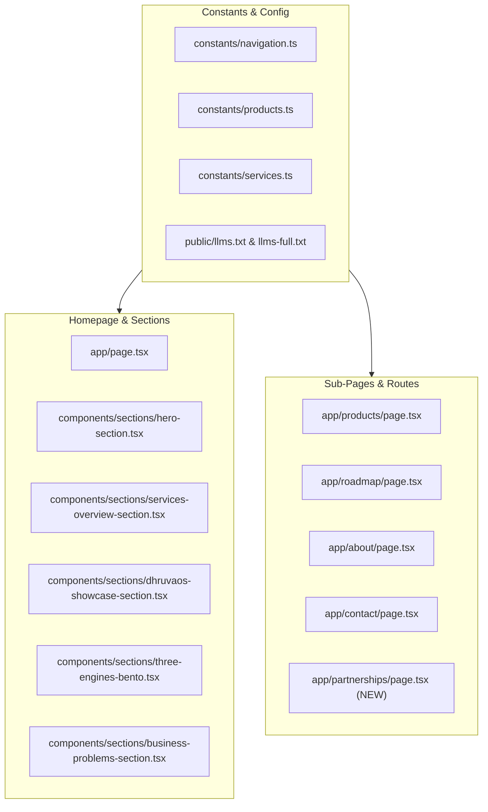

# NEELSTACK SOLUTIONS — MASTER REMEDIATION PLAN (PHASE TWO BLUEPRINT)
**Document ID:** `PLAN-MASTER-REM-09`  
**Date:** 09 November 2026  
**Status:** Awaiting Company Owner Approval  
**Scope:** Actionable implementation blueprint for Phase Two execution  

---

## 1. Executive Remediation Summary

This master remediation plan synthesizes findings from all 8 comprehensive audit modules (`Business Positioning`, `Content Accuracy`, `Technical SEO`, `GEO/AEO`, `UX & Design`, `Conversion Funnels`, `Security Claims`, and `Route Matrix`).
It establishes a strict, priority-ordered roadmap to transition NeelStack from a perceived loose collection of products and services into an **authoritative, AI-native technology and software engineering company** that is ready for enterprise procurement and tier-1 vendor partnerships.

---

## 2. Priority-Ordered Action Roadmap

### Phase 2.1 — P0 Critical Remediations (Positioning, Flagship & Date Harmony)
| ID | Issue | Target Files | Action Required | Verification |
| :--- | :--- | :--- | :--- | :--- |
| `P0-1` | **DhruvaOS Flagship Prominence** | `constants/products.ts`, `app/products/page.tsx`, `components/sections/dhruvaos-showcase-section.tsx` | Elevate DhruvaOS to #1 flagship product across all menus, listings, and homepage showcases. Present ToolVines as an independent live utility. | Verify visual hierarchy on `/` and `/products`. |
| `P0-2` | **Resolve Conflicting Launch Dates** | `public/llms-full.txt`, `public/llms.txt`, `constants/products.ts`, `app/roadmap/page.tsx`, `app/about/page.tsx` | Purge all residual mentions of "October 2026". Standardize universally to: *"Beta Live / Early Institutional Pilots · Launching 14 November 2026"*. | Automated regex scan for `October` in product copy. |
| `P0-3` | **Workforce Transparency Mandate** | `constants/services.ts`, `app/about/page.tsx`, `public/llms.txt` | Explicitly define the engineering workforce delivery model: direct core architects supplemented by screened contract professionals and approved delivery partners under strict IP assignment. | Review legal compliance wording. |
| `P0-4` | **Standardize Product Maturity Statuses** | `constants/products.ts`, `app/products/page.tsx`, `app/roadmap/page.tsx` | Standardize four distinct labels: `Live`, `Beta`, `In Development`, and `Planned`. Reclassify AI Company OS as "R&D Architecture & Framework v1.0". | Verify badge consistency across all cards. |

---

### Phase 2.2 — P1 High Priority Remediations (Services Architecture & Division 3)
| ID | Issue | Target Files | Action Required | Verification |
| :--- | :--- | :--- | :--- | :--- |
| `P1-1` | **Dedicated Legacy Modernization Service** | `constants/services.ts`, `app/services/page.tsx`, `components/sections/services-overview-section.tsx` | Promote Legacy System Modernization to a tier-1 service (`/services/legacy-modernisation`). Detail strangler-fig pattern, dual-write sync, and risk management. | Static page build and routing check. |
| `P1-2` | **Introduce Contract Engineering & Dedicated Teams** | `constants/services.ts`, `constants/navigation.ts`, `app/services/page.tsx` | Add dedicated service entries: `/services/contract-engineering` and `/services/dedicated-teams`. Detail developer screening, pod sizes (3–8), and sprint governance. | Static page build and routing check. |
| `P1-3` | **Introduce AI Data Operations & Model Evaluation** | `constants/services.ts`, `constants/navigation.ts`, `app/services/page.tsx` | Add dedicated service entries: `/services/ai-data-annotation` and `/services/ai-model-evaluation`. Detail RLHF, vernacular Indian language validation, and QA pipelines. | Static page build and routing check. |
| `P1-4` | **Vendor Partnership & Subcontracting Portal** | `app/partnerships/page.tsx` (new), `constants/navigation.ts` | Build dedicated `/partnerships` page for enterprise IT system integrators (TCS, Accenture, Cognizant) detailing vendor onboarding and subcontracting terms. | Verify route in `sitemap.ts` and UI. |
| `P1-5` | **Qualify All Absolute Claims** | `constants/services.ts`, `components/sections/business-problems-section.tsx`, `components/sections/three-engines-bento.tsx` | Replace "99.99% uptime" with "High-Availability Multi-AZ Architecture"; replace "40%+ cost reduction" with "Compute & Infrastructure Rightsizing"; qualify HIPAA/DISHA to "Architectural Readiness". | Grep verification for unverified claims. |

---

### Phase 2.3 — P2 Medium Priority Remediations (UX, Typography & Conversion)
| ID | Issue | Target Files | Action Required | Verification |
| :--- | :--- | :--- | :--- | :--- |
| `P2-1` | **Header Navigation Hierarchy Update** | `constants/navigation.ts`, `components/navigation/header.tsx` | Restructure header into 3 divisions: *Products* (DhruvaOS, ToolVines), *Enterprise Services* (Custom Software, Modernization, AI, Cloud), and *Workforce & Teams* (Contract Developers, Dedicated Pods, Data Ops). | Desktop and mobile drawer inspection. |
| `P2-2` | **Spelling Drift Correction** | `constants/navigation.ts`, `app/roadmap/page.tsx` | Correct `NaukriMitra` -> `NaukariMitra`, `SarakariMitra` -> `SarkariMitra` across navigation arrays and text anchors. | Code search for spelling anomalies. |
| `P2-3` | **Persona-Specific Contact Form Selectors** | `app/contact/page.tsx`, `app/book-consultation/page.tsx`, `lib/validation.ts` | Add intake options for all 7 buyer personas (DhruvaOS Demo, Modernization Audit, Contract Developers, AI Evaluation, Vendor Subcontracting). | Unit tests in `test/validation.test.mjs`. |
| `P2-4` | **Section Spacing & Typography Polish** | `app/globals.css`, `components/sections/hero-section.tsx` | Increase section padding to `py-20 lg:py-28` to match Baytech Consulting's spacious visual discipline; ensure hero headlines stay strictly locked to 2 clean lines. | Cross-browser responsive rendering. |

---

### Phase 2.4 — P3 Low Priority Remediations (SEO & Entity Linking)
| ID | Issue | Target Files | Action Required | Verification |
| :--- | :--- | :--- | :--- | :--- |
| `P3-1` | **Knowledge Graph SameAs Array** | `app/page.tsx`, `app/about/page.tsx` | Add official LinkedIn, GitHub, X, and YouTube URLs to Organization JSON-LD schema. | Google Rich Results validation. |
| `P3-2` | **Breadcrumb Schema Standardization** | `components/navigation/breadcrumb.tsx` | Ensure `BreadcrumbList` JSON-LD is universally emitted on all dynamic subroutes. | Schema validation test. |

---

## 3. Exact Files Impact Matrix

---

## 4. Verification & Validation Protocol

After authorising Phase Two implementation, the changes must pass the mandatory quality gate:
1. **Unit Testing:** `pnpm run test` (All 25 existing unit tests + new validation tests passing).
2. **ESLint Verification:** `pnpm run lint` (0 errors, 0 warnings).
3. **TypeScript Compilation:** `pnpm exec tsc --noEmit` (0 type errors).
4. **Turbopack Production Build:** `pnpm run build` (Clean prerendering of all 155+ static routes).
5. **No Broken Links:** Verify all internal links resolve; no `404` or orphan routes.
6. **No Exposed Secrets:** Verify zero tokens or credentials in working tree.
7. **Git Constraint Compliance:** **NEVER COMMIT OR PUSH** without explicit user instruction.
