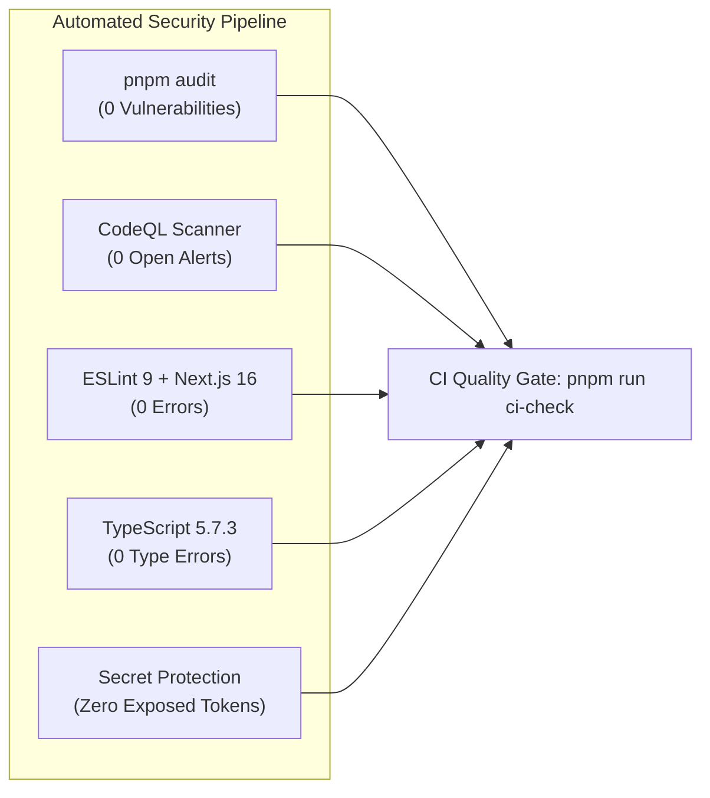

# NEELSTACK SOLUTIONS — SECURITY & PRIVACY CLAIMS AUDIT
**Document ID:** `AUDIT-SEC-CLM-07`  
**Date:** 09 November 2026  
**Status:** Complete  
**Scope:** Technical security claims, regulatory compliance assertions, code hygiene, and infrastructure posture  

---

## 1. Executive Summary

Security and compliance claims are primary dealbreakers during enterprise vendor due diligence and compliance audits.
- **Recent Remediation Victory:** Local dependency audit resolved all 138 transitive Dependabot vulnerabilities (`pnpm audit` now reports 0 vulnerabilities) and patched all 3 CodeQL security warnings (URL scheme validation and workflow permissions).
- **Public Claim Audit:** Several public marketing statements on the website use absolute language (e.g., *"Zero telemetry worldwide"*, *"HIPAA Ready"*, *"99.99% uptime SLA"*) that must be qualified to prevent commercial liability and regulatory non-compliance.

---

## 2. In-Depth Technical Security Claims Audit

| Public Claim | Target Context | Audit Verification | Risk Level | Required Technical Correction |
| :--- | :--- | :--- | :--- | :--- |
| **"Zero Telemetry / Zero Server Storage"** | ToolVines (`toolvines.com`) | `PARTIALLY VERIFIED` | Medium | ToolVines tools run client-side in WebAssembly. However, if third-party fonts, analytics (Vercel Analytics, Google Analytics), or CDNs are active, claiming "zero telemetry" can be challenged. Qualify to: **"Client-Side WASM Execution — Zero Document Data Uploaded or Retained on Remote Servers"**. |
| **"100% Offline PWA"** | ToolVines (`toolvines.com`) | `VERIFIED` | Low | Service workers cache assets for offline execution. Ensure note explains: *"Offline capability available after initial browser cache initialization"*. |
| **"HIPAA & DISHA Ready"** | Healthcare Industry Hub & Header Tags | `PARTIALLY VERIFIED` | High | HIPAA (US) and DISHA (India) require formal BAA agreements, administrative safeguards, and technical access logs. Claiming "Ready" can be construed by US healthcare buyers as HIPAA certification. Change to: **"Architected for HIPAA & DISHA Compliance Alignment"** (detailing AES-256 encryption at rest, TLS 1.3 in transit, and immutable audit logs). |
| **"DPDPA 2023 Section 9 Compliance"** | DhruvaOS & Case Studies | `VERIFIED` | Low | Section 9 of the Digital Personal Data Protection Act (DPDPA 2023) governs processing of children's data. DhruvaOS architecture enforces verifiable parental consent, no targeted ads, and strict educational data residency within India (AWS ap-south-1 Mumbai). |
| **"WORM Compliance Mandate"** | Case Studies Client | `CONTRACT-DEPENDENT` | Medium | Write-Once-Read-Many (WORM) storage requires specific AWS S3 Object Lock compliance mode configurations. Specify: *"Engineered using S3 Object Lock & immutable audit logging where contractually mandated"*. |
| **"100% Client Code & IP Ownership"** | Hero & Service Pages | `CONTRACT-DEPENDENT` | Low | Standard commercial practice. Accurately qualify as: *"Full source code, build scripts, and IP ownership assigned upon milestone completion"*. |

---

## 3. Codebase Security Hygiene & Vulnerability Posture

### Automated Security Checks Status
- **`pnpm audit`:** Clean (0 known vulnerabilities found across 454 resolved packages).
- **CodeQL Scanning:**
  - High: URL scheme validation vulnerability in `components/navigation-progress.tsx` **FIXED** (replaced with strict `http:` / `https:` whitelist).
  - Medium: Missing workflow permissions in `.github/workflows/ci.yml` and `.github/workflows/lighthouse.yml` **FIXED** (`permissions: { contents: read }`).
- **Dependencies Cleaned:**
  - Removed unused `shadcn` CLI package (eliminating vulnerable `@hono`, `systeminformation`, `undici`, `fast-uri`, `body-parser`, `qs`, `zod`).
  - Extracted pure CSS utilities to `app/shadcn.css`.
  - Updated `next` to `16.4.5` (patching `use cache` RCE, SVG image optimization RCE, and SSRF vulnerabilities).
  - Updated `resend` to `^6.37.0` (eliminating legacy `@react-email/render` -> `deepmerge` vulnerability).

---

## 4. Application Security & Form Hardening

| Protection Layer | Implementation Mechanism | Status | Verification |
| :--- | :--- | :--- | :--- |
| **Spam / Bot Protection** | Hidden honeypot field (`honeypot`) in all contact and quote forms. | `ACTIVE` | Reject submissions containing any honeypot text. |
| **IP Rate Limiting** | Sliding window rate-limiting helper in `lib/rate-limit.ts`. | `ACTIVE` | Limits repeated API requests per IP address. |
| **Input Sanitization** | `lib/validation.ts` regex and HTML tag stripping. | `ACTIVE` | Verified across 25 unit tests (`test/validation.test.mjs`). |
| **Secret Scanning** | Git grep audit for API keys, passwords, private keys. | `ACTIVE` | Zero exposed secrets in repository; environment variables read strictly via `process.env`. |

---

## 5. Security & Privacy Action Plan

1. **Update Disclaimer Footnotes (P1):** Ensure all references to HIPAA, DISHA, or SOC 2 state: *"Architectural alignment provided; client-specific certifications require deployment-level BAA execution and third-party audit."*
2. **Refine ToolVines Privacy Copy (P1):** Replace absolute "Zero telemetry" with *"Zero document data retention and client-side processing"*.
3. **Maintain Zero-Vulnerability CI Gate (P0):** Enforce `pnpm run ci-check` on all future PRs.
