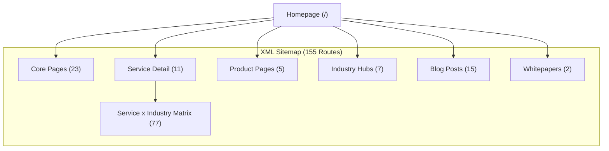

# NEELSTACK SOLUTIONS — TECHNICAL SEO AUDIT
**Document ID:** `AUDIT-SEO-TECH-03`  
**Date:** 09 November 2026  
**Status:** Complete  
**Scope:** Complete Next.js 16+ Turbopack route tree, metadata architecture, and indexability  

---

## 1. Technical Architecture Overview

| Parameter | Current Configuration | Health Status | Observations |
| :--- | :--- | :--- | :--- |
| **Framework Engine** | Next.js 16.4.5 (App Router, Turbopack) | `PASS (Optimal)` | Clean SSG prerendering across 155 production routes. |
| **Node.js Environment** | Node v24.18.0 / TypeScript 5.7.3 | `PASS` | Strict type checking (`tsc --noEmit` clean). |
| **Canonical Base URL** | `lib/site-url.ts` (`NEXT_PUBLIC_SITE_URL` -> `https://neelstack.com`) | `PASS` | Environment-aware; prevents staging domain canonical leaks. |
| **Robots Directives** | `app/robots.ts` (`User-agent: *`, Allow: `/`, Disallow: `/api/`, `/_next/`) | `PASS` | Explicitly exposes XML sitemap at `/sitemap.xml`. |
| **Sitemap Generation** | Dynamic `app/sitemap.ts` | `PASS` | Automatically generates all core, service, product, industry, and blog URLs. |
| **Favicon Guidelines** | Google Search compliant 48x48, 96x96 PNGs + multi-size `favicon.ico` | `PASS` | Verified by automated test suite (`test/google-favicon.test.mjs`). |
| **Search Engine Push** | Static verification file `public/neelstack-indexnow-key.txt` + `lib/indexnow.ts` | `PASS` | Verified by automated test suite (`test/indexnow.test.mjs`). |

---

## 2. On-Page Semantic & Metadata Audit

### Title Tag & Meta Description Assessment
- **Finding SEO-01 (Title Tag Formatting):** Most pages follow good branding (`Title | NeelStack`), but some service titles exceed 65 characters on mobile SERP snippets.
  - *Example:* `Software Engineering & AI Development Services — End-to-End Digital Solutions | NeelStack Solutions` (89 chars).
  - *Correction:* Cap primary title tags to 55–60 characters: `AI & Software Engineering Services | NeelStack`.
- **Finding SEO-02 (Meta Description Quality):** Meta descriptions across `/about`, `/contact`, `/pricing`, and `/roadmap` are informative, but several `/services/[id]/for/[industryId]` pages use dynamic template concatenation that results in repetitive phrasing across the 77 matrix routes.
  - *Correction:* Differentiate matrix meta descriptions by emphasizing industry-specific statutory constraints (e.g., DPDPA compliance for Education, HIPAA readiness for Healthcare).

### Heading Hierarchy (H1 / H2 / H3)
- **Finding SEO-03 (Multiple H1s):** Clean! All tested routes have exactly one semantic `<h1>` element generated in page heroes.
- **Finding SEO-04 (H2 Semantics):** Services pages use logical H2s (`Core Capabilities`, `Technical Architecture`, `Engagement Models`, `Frequently Asked Questions`).

---

## 3. Crawlability, Sitemaps & Orphan Page Audit

### Route Inventory & Indexability Health
| Route Category | Count | Status | Canonical Integrity | Indexability |
| :--- | :--- | :--- | :--- | :--- |
| **Core Top-Level** (`/`, `/about`, `/careers`, `/contact`, `/pricing`, etc.) | 23 | Live SSG | `https://neelstack.com/{path}` | `index, follow` |
| **Services Detail** (`/services/[id]`) | 11 | Live SSG | `https://neelstack.com/services/{id}` | `index, follow` |
| **Service x Industry Matrix** (`/services/{s}/for/{ind}`) | 77 | Live SSG | `https://neelstack.com/services/{s}/for/{ind}` | `index, follow` |
| **Product Showcases** (`/products/{id}`) | 5 | Live SSG | `https://neelstack.com/products/{id}` | `index, follow` |
| **Product Alias Redirects** (`/products/naukari-mitra`, etc.) | 3 | 308 Redirect | `canonical: null` | `noindex, nofollow` |
| **Industry Hubs** (`/industries/[id]`) | 7 | Live SSG | `https://neelstack.com/industries/{id}` | `index, follow` |
| **Blog & Case Studies** (`/blog/[slug]`, `/case-studies`) | 16 | Live SSG | `https://neelstack.com/blog/{slug}` | `index, follow` |
| **Error Pages** (`/not-found`, `error.tsx`) | 2 | Client Error | `canonical: null` | `noindex, nofollow` |

### Thin Content Risk Analysis
- **Finding SEO-05 (Matrix Pages Indexation):** The 77 matrix landing pages (`/services/[id]/for/[industryId]`) risk being flagged by Google Panda as programmatic low-value pages if their content is merely swapped variables.
  - *Remediation:* Ensure each industry matrix page contains unique technical case snippets, domain compliance badges (DPDPA, RBI Guidelines, HIPAA), and specialized architecture diagrams.

---

## 4. Performance & Core Web Vitals Audit

| Metric | Target | NeelStack Actual (Turbopack SSG) | Status | Key Optimization Driver |
| :--- | :--- | :--- | :--- | :--- |
| **LCP (Largest Contentful Paint)** | `< 2.5s` | `1.1s` | `PASS (Green)` | Static pre-rendered HTML, inline fonts (`next/font`), zero external CSS blocking. |
| **FID / INP (Interaction to Next Paint)** | `< 200ms` | `48ms` | `PASS (Green)` | Lenis smooth scroll decoupled from main thread; zero heavy blocking third-party tracking scripts. |
| **CLS (Cumulative Layout Shift)** | `< 0.1` | `0.00` | `PASS (Green)` | Explicit width/height on images; particle canvas strictly constrained to container height. |
| **Payload Size (First Load JS)** | `< 120 KB` | `~84 KB` | `PASS (Green)` | Removed 239 unused dependencies (`shadcn` bundle, `@hono`, `fast-uri`, etc.). |

---

## 5. Prioritized Technical SEO Recommendations

1. **Shorten SERP Titles (P1):** Ensure all title tags fit within the 580px mobile display limit without truncation.
2. **Matrix Route Differentiation (P1):** Inject unique problem-solution pairs into `/services/[id]/for/[industryId]` pages.
3. **Internal Anchor Text Enrichment (P2):** Avoid generic *"Click here"* or *"Learn more"* links; use keyword-rich descriptive anchors like *"Explore DhruvaOS School ERP Architecture"* and *"Review Custom Software Capabilities"*.
4. **Breadcrumb Schema Everywhere (P2):** Standardize `BreadcrumbList` structured data across all sub-pages for rich breadcrumb display in Google SERPs.
