# NEELSTACK SOLUTIONS — WEBSITE UX & INTERACTION DESIGN AUDIT
**Document ID:** `AUDIT-UX-DES-05`  
**Date:** 09 November 2026  
**Status:** Complete  
**Scope:** Responsive layout, navigation architecture, typography, micro-interactions, and accessibility  
**Benchmark Reference:** [Baytech Consulting](https://www.baytechconsulting.com/) vs. NeelStack Solutions  

---

## 1. Executive Summary

NeelStack's frontend features high-craft neo-brutalist tactile elevation (`.tactile-card-3d`), zero-FOUC theme switching, and an interactive particle displacement logo.
However, compared to the benchmark at Baytech Consulting, certain areas carry **excessive cognitive load**:
1. **Hero Column Weighting:** Hero left-side headline previously risked word-breaking; now stabilized at 58% width with 2-line natural wrap.
2. **Navigation Grouping:** The header navigation groups 11 services and 5 products in a dense mega-menu without a distinct high-level separation of the three company divisions.
3. **Card Density:** Multiple sections display dense technical tags and metrics that compete for visual attention. Adopting Baytech's minimal typography discipline will enhance executive readability.

---

## 2. Navigation Architecture Audit

```mermaid
graph TD
    HEADER["Top Navigation Bar"]
    
    HEADER --> NAV_SERVICES["Services ▾"]
    HEADER --> NAV_PRODUCTS["Products ▾"]
    HEADER --> NAV_WORKFORCE["Workforce & Teams ▾ (NEW)"]
    HEADER --> NAV_COMPANY["Company ▾"]
    HEADER --> NAV_PRICING["Pricing"]
    HEADER --> NAV_CONTACT["Contact"]
    
    NAV_SERVICES --> NS_1["Custom Software Development"]
    NAV_SERVICES --> NS_2["AI & Agent Development"]
    NAV_SERVICES --> NS_3["Legacy System Modernization"]
    NAV_SERVICES --> NS_4["Cloud Architecture & DevOps"]
    NAV_SERVICES --> NS_5["Web & Mobile Engineering"]
    
    NAV_PRODUCTS --> NP_1["DhruvaOS (FLAGSHIP School ERP)"]
    NAV_PRODUCTS --> NP_2["ToolVines (Live Browser Tools)"]
    NAV_PRODUCTS --> NP_3["AI Company OS (Whitepaper R&D)"]
    
    NAV_WORKFORCE --> NW_1["Contract Software Developers"]
    NAV_WORKFORCE --> NW_2["Dedicated Engineering Pods"]
    NAV_WORKFORCE --> NW_3["AI Model Evaluation & Data Ops"]
```

### Key Navigation Findings:
- **Finding UX-01 (Missing Workforce Pillar):** Enterprise clients looking for staff augmentation or dedicated teams cannot find a clear navigation entry point.
- **Finding UX-02 (Mobile Drawer Navigation):** The mobile drawer collapses complex submenus into an accordion. It is functionally solid, but needs clear division headings so users don't get lost in 16+ links.
- **Finding UX-03 (Header Action Consistency):** The header has "Book Consultation" and "Talk AI". A single, strong primary action ("Schedule Consultation") aligns best with B2B enterprise conversion.

---

## 3. Typography & Visual Rhythm Comparison

| Design Dimension | Baytech Consulting Standard | NeelStack Current State | Target Enhancement |
| :--- | :--- | :--- | :--- |
| **Headline Geometry** | Single concise phrase, heavy contrast, ultra-clean font. | Dynamic carousel with 5 slides. | Retain 5-slice capability narrative, but ensure left copy stays locked to max 2 lines with relaxed leading (`leading-[1.15]`). |
| **Spacing & Whitespace** | `py-24` to `py-32` between sections; breathable visual rest areas. | `py-10` to `py-20` with tight vertical compression. | Increase vertical breathing room (`py-16 sm:py-24`) to eliminate visual clutter between major content blocks. |
| **Hero Graphic** | Freely floating interactive particle canvas without box containers. | Particle logo canvas successfully updated to floating style with slide-matching color morphing. | Maintained. Keep zero-border free-floating aesthetic across all viewport sizes. |
| **Card Presentation** | Flat dark surfaces with subtle 1px border hover glows. | Hard-offset neo-brutalist offset drop-shadow (`4px 4px 0px 0px`). | Retain NeelStack's signature neo-brutalist tactile elevation, but reduce visual noise inside cards by pruning redundant tag badges. |

---

## 4. Accessibility & Form Validation Audit

### Form Usability (Contact, Consultation, Quote)
- **Validation Engine:** `lib/validation.ts` backed by 25 automated unit tests (`test/validation.test.mjs`).
- **Input Fields:** Strict RFC-compliant email checks, international phone formatting, and required field highlighting.
- **Spam & Abuse Protection:** Client-side Honeypot fields (`honeypot` input hidden from screen readers) + IP rate limiting in `app/api/contact/route.ts`.
- **Keyboard Navigation:** Forms support full tab traversal, explicit focus rings (`focus-visible:ring-2 focus-visible:ring-primary`), and `Enter` key submission.

### WCAG 2.1 AA Contrast Compliance
- **Dark Mode:** Foreground `oklch(0.97 0 0)` on Background `oklch(0.08 0.018 255)` achieves an **11.4:1 contrast ratio** (well above the 4.5:1 requirement).
- **Light Mode:** Foreground `oklch(0.10 0.018 255)` on Background `oklch(0.99 0 0)` achieves a **14.2:1 contrast ratio**.
- **Interactive Buttons:** Secondary and tactile buttons meet 3:1 boundary contrast standards.

---

## 5. Prioritized UX Enhancements

1. **Section Spacing Expansion (P1):** Increase vertical padding on desktop viewports (`py-20 lg:py-28`) for a more authoritative, relaxed enterprise feel like Baytech.
2. **Prune Badge Clutter (P1):** Limit card badges to a maximum of 3 key technology tags per service card.
3. **Dedicated Division 3 Nav Category (P0):** Add dedicated workforce & staffing dropdown in header.
4. **Hero Dual CTA Optimization (P2):** Primary: *"Schedule Consultation"*, Secondary: *"Explore Services"*.
